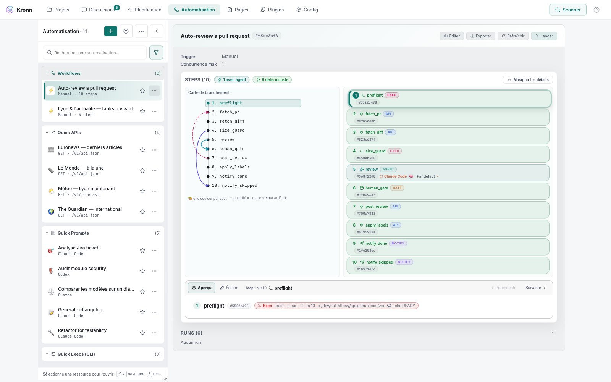
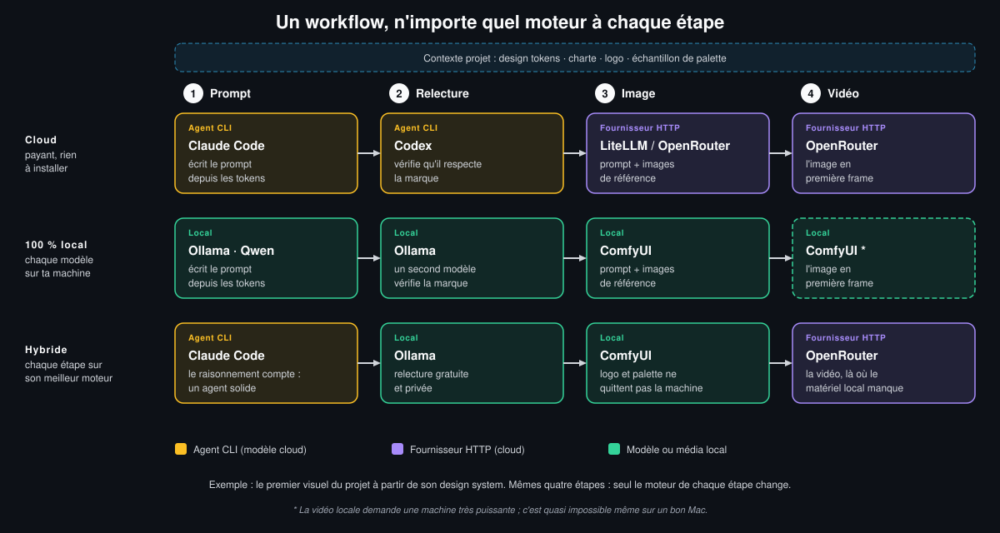
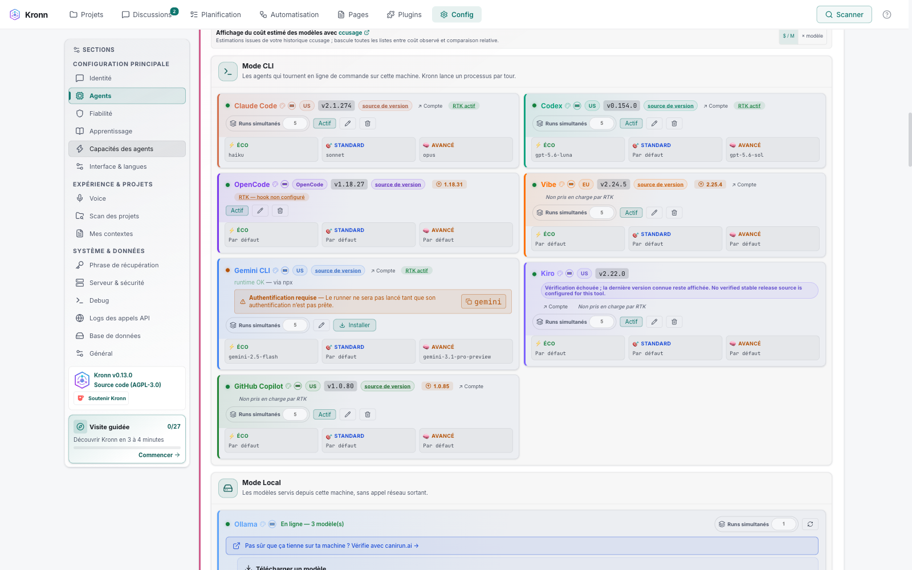
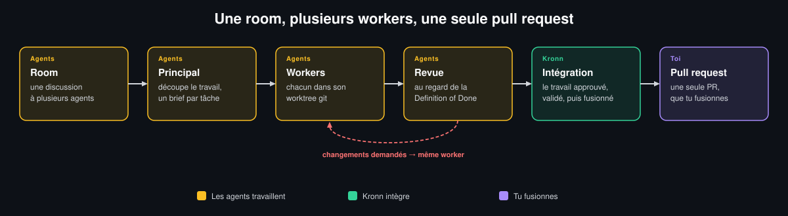
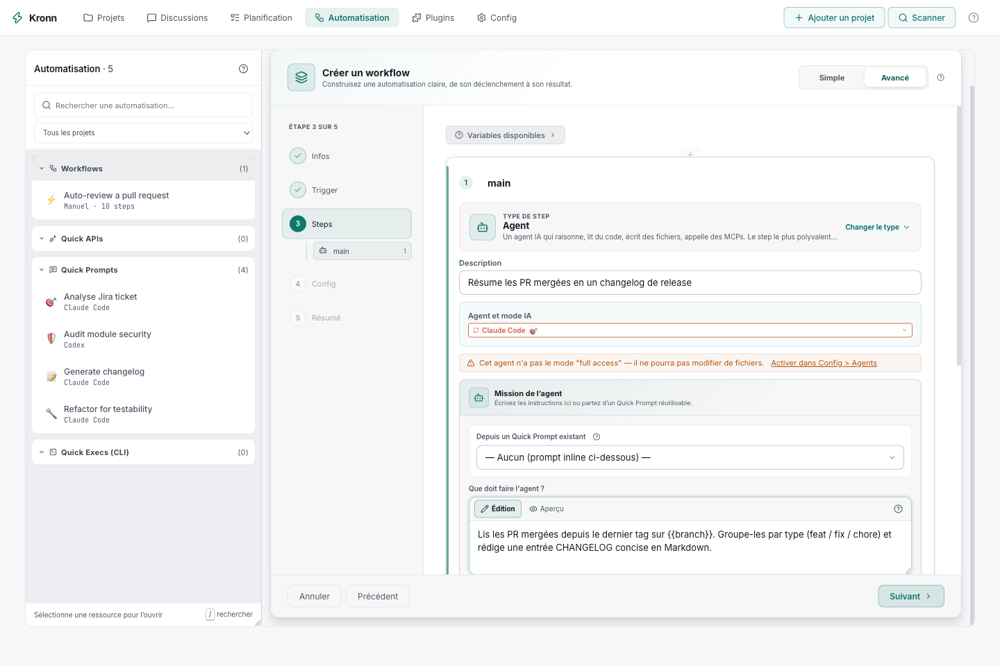
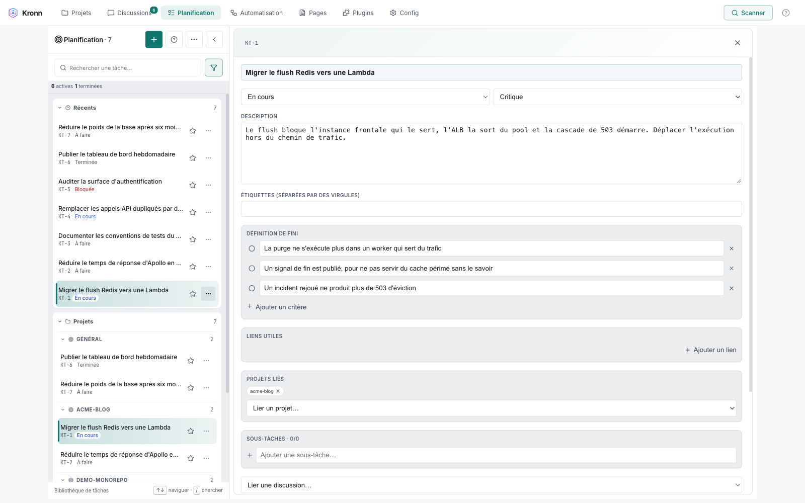
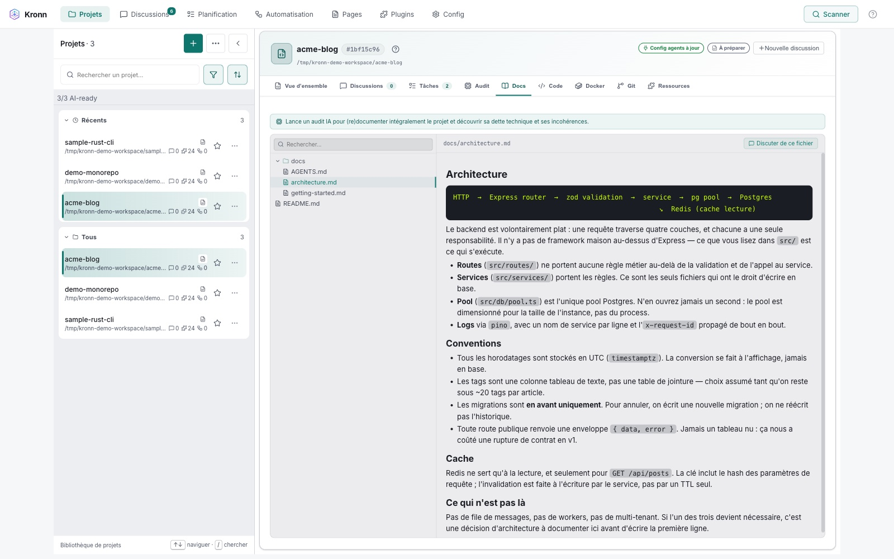
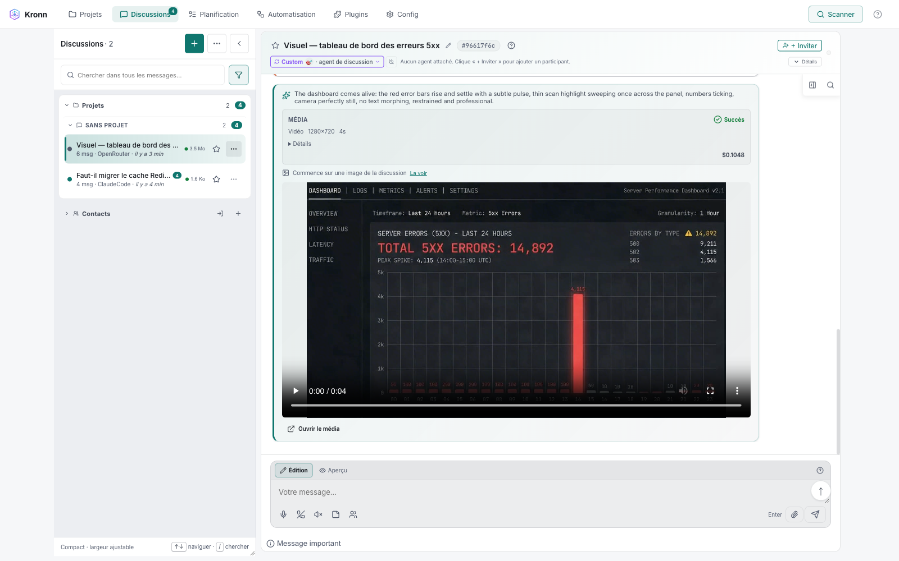
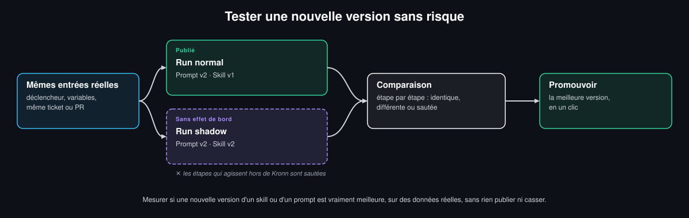
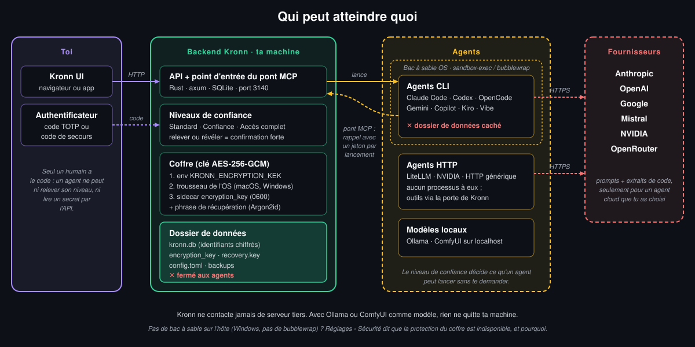

<p align="center"></p>

<p align="center">
  <a href="https://docroms.github.io/Kronn/"></a>
  &nbsp;
  <a href="README.md"></a>
</p>

<p align="center">
  <a href="https://github.com/DocRoms/Kronn/releases/latest"></a>
  <a href="LICENSE"></a>
  <a href="https://github.com/DocRoms/Kronn/actions"></a>
</p>

<p align="center">
  <a href="https://github.com/DocRoms/Kronn/stargazers"></a>
  <a href="https://github.com/DocRoms/Kronn/commits/main"></a>
  <a href="CONTRIBUTING.md"></a>
  <a href="https://github.com/DocRoms/Kronn/issues?q=is%3Aopen+label%3A%22good+first+issue%22"></a>
</p>

**Pilote tes agents de code (Claude Code, Codex, Gemini CLI, OpenCode…), tes modèles locaux avec Ollama et tes fournisseurs HTTP comme LiteLLM, NVIDIA et OpenRouter depuis un seul dashboard self-hosted, avec des MCP partagés, des secrets chiffrés, des rooms multi-agents et des workflows répétables.**

- **Un onglet au lieu de cinq terminaux :** tous les agents partagent les mêmes MCP *(Model Context Protocol, le standard ouvert qui relie les agents aux outils et aux données)*, les mêmes secrets et le même contexte projet.
- **Du code là où le code suffit :** les workflows exécutent les étapes mécaniques sans token et donnent à chaque agent un petit prompt borné. Voir [l'approche Kronn](docs/guides/the-kronn-way.md).
- **Ta machine, tes règles :** les agents tournent dans un bac à sable de l'OS qui leur cache le coffre de Kronn, au niveau de confiance que tu choisis ; avec Ollama, rien ne quitte ton ordinateur.

> **Statut : 0.15.2 (version actuelle).** Fonctionnel mais pré-1.0. Les versions mineures peuvent introduire des breaking changes ; les patch versions sont safe.
> **Licence : AGPL-3.0.** Utiliser Kronn localement pour développer *ton propre* produit ne déclenche pas le copyleft ; il ne s'applique que si tu redistribues une version modifiée à d'autres. Voir [Notes sur la licence](#notes-sur-la-licence-agpl-30).

## Nouveautés de la 0.15.2

- **Des secrets hors de portée des agents :** niveaux de confiance, bac à sable de l'OS sur le dossier de données, confirmation forte et export de plugin sûr.
- **Des quotas sans travail perdu :** le travail attend puis revient à son fournisseur d'origine, sans repli silencieux.
- **Des rooms qui codent dans d'autres projets, Docker sans compilation :** une room peut recevoir `code` sur le checkout d'un autre projet ; `start` récupère les images multi-architectures publiées.

La liste complète des changements est dans le [CHANGELOG](CHANGELOG.md#0152---2026-11-08).

## Un workflow, n'importe quel moteur

Kronn mélange n'importe quel moteur à chaque étape d'un workflow : agents CLI, fournisseurs HTTP et modèles locaux.
Un exemple, créer le premier visuel du projet à partir de son design system : ① lit les design tokens et la charte du dépôt et écrit le prompt, ② vérifie que le prompt respecte la marque, ③ génère l'image avec les éléments de marque (logo, échantillon de palette) en images de référence, et ④ en fait un court teaser. Les étapes travaillent avec le contexte du projet, pas avec des appels bruts à un modèle.
Le cloud et le 100 % local sont les deux extrêmes : des fournisseurs payants sans rien à installer, ou chaque modèle sur ta machine (Ollama pour le texte, ComfyUI pour les médias).
Le couloir hybride montre la logique : un agent CLI solide là où le raisonnement compte ; du local là où c'est gratuit et privé, pour que les fichiers de marque (logo, palette) ne quittent jamais la machine ; le cloud là où le matériel manque, pour la vidéo.

<p align="center"></p>

<sub>* La vidéo locale demande une machine très puissante ; c'est quasi impossible même sur un bon Mac.</sub>

Importe un couloir : [cloud](docs/examples/design-system-first-visual.cloud.json), [100 % local](docs/examples/design-system-first-visual.local.json) ou [hybride](docs/examples/design-system-first-visual.hybrid.json), puis vois [ce qu'il faut configurer](docs/examples/README.md#design-system-first-visual).

## Sommaire

- [Nouveautés de la 0.15.2](#nouveautés-de-la-0152)
- [Un workflow, n'importe quel moteur](#un-workflow-nimporte-quel-moteur)
- [Capacités clés](#capacités-clés)
- [L'approche Kronn](#lapproche-kronn--de-lingénierie-pas-de-lincantation)
- [Démarrage rapide](#démarrage-rapide)
- [Modèle de sécurité](#modèle-de-sécurité)
- [Concepts](#concepts)
- [Quand Kronn est utile, et quand il ne l'est pas](#quand-kronn-est-utile-et-quand-il-ne-lest-pas)
- [Licence et liens](#licence-et-liens)

---

## Capacités clés

### Tous les agents au même endroit

Onze types d'agents derrière un seul sélecteur : sept agents CLI, Ollama, LiteLLM, NVIDIA et tout endpoint compatible OpenAI, chacun avec ses niveaux Éco / Standard / Avancé et les mêmes MCP.
Les **modèles de décision** d'Ollama répondent à des questions typées avec une probabilité. Voir [les modèles locaux Ollama](docs/operations/ollama-local-models.md#decision-models-kt-1366) et [le transport HTTP](docs/operations/http-transport.md).

<p align="center"></p>

### Rooms et orchestration

Une **room** est une discussion que plusieurs agents rejoignent, sur plusieurs projets si tu le permets.
L'orchestrateur découpe le travail en couloirs de workers, chacun dans son propre worktree git, relit chaque livraison au regard de sa Definition of Done, puis intègre le résultat dans une seule PR. Voir [l'orchestration de tâches](docs/guides/task-orchestration.md).

<p align="center"></p>

### Workflows

Quinze types de step, des steps agent aux steps `ApiCall`, `Exec` et `Gate` à zéro token, lancés à la main, par cron, par un tracker ou par un **Watch** sur une source.
Les skills et les Quick Prompts sont versionnés et peuvent être épinglés sur un step. Voir [le moteur de workflow](docs/architecture/overview.md#workflow-engine).

<p align="center"></p>

### Planification et mémoire

Un seul backlog de **Planification** classe les tâches par bande de priorité et relie chacune, avec ses blocages et sa **Definition of Done**, à plusieurs projets et discussions.
Les agents lisent par MCP seulement la tâche ou le delta dont ils ont besoin. Voir [planification et plans de discussion](docs/design/planning-and-discussion-plans.md).

<p align="center"></p>

### Docs IA du dépôt

Un audit écrit une arborescence `docs/` que chaque agent lit comme contexte projet ; la revalidation ne réaudite que ce qui a dérivé.
L'audit complet est chaîné : 9 étapes de docs, puis chaque passe ciblée (sécurité, performance, accessibilité, qualité du code…), 16 étapes en un seul lancement.
La garde anti-hallucination signale les fichiers et lignes inventés. Voir [le guide d'audit](docs/guides/ai-audit.md) et [la garde anti-hallucination](docs/conventions/anti-hallucination-guard.md).

<p align="center"></p>

### Pages vivantes et médias

Un **Artifact** (Page vivante) est un rapport HTML isolé et versionné, alimenté par les jeux de données des workflows, dont les boutons de ligne lancent un Quick Prompt, un appel d'API ou un workflow.
Une image ou un clip peut partir de plusieurs images sources, ComfyUI compris (FLUX.2 Klein 4B en prend jusqu'à quatre), et une étape de workflow sur un agent local ou HTTP (Ollama, LiteLLM…) génère elle-même ses médias. Les clips générés s'enchaînent en un seul film dans la discussion. Voir [les Pages vivantes](docs/architecture/live-pages.md) et [la génération de médias](docs/architecture/media-generation.md).

<p align="center"></p>

## L'approche Kronn : de l'ingénierie, pas de l'incantation

Découper : le code fait ce que le code sait faire (récupérer, transformer, lancer une commande) sans dépenser de token, et un agent n'intervient que là où il faut du jugement, avec un prompt court et borné.
Mesurer : les skills et les Quick Prompts sont versionnés, et un run shadow montre si une nouvelle version est vraiment meilleure avant sa mise en service. Voir [l'approche Kronn](docs/guides/the-kronn-way.md).

### Tester une nouvelle version sans risque (runs shadow)

Chaque run normal d'un workflow peut lancer un run shadow sur les mêmes entrées réelles, qui charge la version du skill ou du Quick Prompt que tu testes.
Chaque étape marquée comme agissant hors de Kronn (publier, envoyer, écrire ailleurs) est sautée dans le shadow, comme chaque Gate : il ne publie ni ne casse rien.
La liste des runs compare les deux runs étape par étape, et un clic promeut la meilleure version. Voir [le guide des runs shadow](docs/guides/shadow-runs.md) (en anglais).

<p align="center"></p>

---

## Démarrage rapide

**Prérequis :** au moins un agent CLI local, [Ollama](https://ollama.com) ou un proxy LiteLLM existant. Kronn pilote le runtime que tu utilises déjà ; il n'embarque pas son propre LLM. L'assistant d'installation détecte ce qui est dans ton `$PATH`, avec un repli `npx` pour les agents publiés sur npm.

### Application desktop : recommandée pour un usage solo

Télécharge l'installeur de ton OS depuis les [Releases](https://github.com/DocRoms/Kronn/releases/latest). Ni Docker, ni runtime supplémentaire. Étapes par OS dans [docs/install.md](docs/install.md).

### Docker : images publiées

```bash
git clone --branch 0.15.2 --depth 1 https://github.com/DocRoms/Kronn.git   # dernière version stable
cd Kronn
./kronn start        # installation guidée et lancement (Docker) → http://localhost:3140
```

`./kronn start` (et `make start`) récupère les images publiées (`ghcr.io/docroms/kronn-backend` et `-frontend`, amd64 et arm64) et ne compile rien. Les builds depuis les sources, leur vérification mémoire et la façon dont `VERSION` choisit l'image : [docs/install.md](docs/install.md#published-images-and-source-builds). Sous Windows, passe par WSL2.

### macOS et contributeurs : `start-dev`

Docker sur macOS ne peut ni lancer tes agents hôtes ni lire le Trousseau : sur Mac, utilise `./kronn start-dev`, qui lance le backend et l'UI en natif, avec rechargement à chaud du backend. Il faut Rust, Node ≥ 24, pnpm et Watchexec ; la commande nomme chaque outil manquant avec une piste d'installation. Détails : [docs/install.md](docs/install.md#develop--run-from-source-natively-no-app-build-hot-reload).

**Les 5 premières minutes :** ouvre un projet trouvé par l'assistant (Kronn reprend son `.mcp.json`), lance une discussion avec un agent, puis enregistre un prompt utile comme Quick Prompt avec des `{{variables}}`. Pour du travail en plusieurs étapes, planifié ou soumis à validation, passe à un [workflow](docs/architecture/overview.md#workflow-engine).

---

## Modèle de sécurité

<p align="center"></p>

- **Niveaux de confiance.** Standard (chaque action sensible demande), Confiance et Accès complet, réglés pour l'instance, un workflow ou une room ; le réglage le plus étroit l'emporte. Un niveau n'approuve à ta place que ce qui te protège de tes propres agents, le journalise et le reprend quand tu le baisses. Voir [les niveaux de confiance](docs/architecture/trust-levels.md).
- **Bac à sable de l'OS.** Les processus d'agents natifs et tout ce qu'un niveau approuve tournent sous `sandbox-exec` (macOS) ou bubblewrap (Linux), qui cache le dossier de données de Kronn : base, clés, configuration, sauvegardes. Le réseau et tes autres fichiers restent comme dans ton terminal. Sans bac à sable (Windows, pas de bubblewrap), Réglages › Sécurité indique que la protection est indisponible. Voir [la protection du coffre](docs/architecture/agent-vault-protection.md).
- **Confirmation forte.** Une fois une application d'authentification enregistrée (TOTP, plus dix codes de secours), relever un niveau de confiance et les routes qui révèlent un secret ou détruisent des données demandent son code, quel que soit le canal, loopback compris. Voir [les routes à confirmation forte](docs/architecture/strong-confirmation-routes.md).
- **Le coffre.** Les identifiants sont chiffrés (AES-256-GCM) dans la base ; `config.toml` ne contient aucun secret. La clé vient d'une échelle : la variable d'environnement `KRONN_ENCRYPTION_KEK`, puis le trousseau de l'OS (builds de release macOS et Windows ; Linux n'en a pas), puis un fichier sidecar `encryption_key` (`0600`) dans le dossier de données. Une phrase de récupération (Argon2id) enveloppe la clé dans `recovery.key`, qui survit ainsi à la perte de la machine. Voir [la gestion des clés](docs/operations/key-management.md).
- **Reste local.** Les prompts ne partent que vers le fournisseur *que tu as choisi* (personne, avec Ollama). Kronn ne contacte jamais de serveur tiers.
- **Frontière conteneur/hôte.** En mode Docker, ton `$HOME` est monté en lecture seule, les chemins d'identifiants trouvés (`~/.ssh`, `~/.aws`, …) sont masqués et aucun socket Docker n'est monté par défaut. Voir [docs/install.md](docs/install.md).
- **Durcissement.** Garde-fous SSRF sur les plugins API (RFC 1918, IPv6 ULA, détection du DNS rebinding). Les steps `Exec` passent par une allowlist, sans `sh -c`, avec des argv littéraux uniquement. Auth et TLS : [docs/operations/auth-and-tls.md](docs/operations/auth-and-tls.md).
- **Bus factor.** Un seul mainteneur principal aujourd'hui, AGPL-3.0, toute la doc de conception et de contribution sous [docs/](docs/AGENTS.md). Les forks sont bienvenus ; on peut remplacer n'importe quel backend d'agent sans toucher au moteur.

---

## Concepts

| Terme | Ce que c'est |
|---|---|
| **Projet** | Un dépôt git que Kronn connaît, avec ses docs IA et sa détection de dérive. |
| **Discussion / room** | Un échange avec un agent, un débat multi-agents, ou une room que plusieurs CLI rejoignent par MCP ; éventuellement dans son propre worktree git. |
| **Tâche, plan, DoD** | Une tâche classée, partagée entre projets et discussions, avec sous-tâches, blocages et Definition of Done. |
| **Worker** | Un agent qui exécute une tâche dans son propre worktree et sa sous-discussion, relu par le principal de la room. |
| **Quick Prompt / Quick API / Quick Exec** | Modèle de prompt réutilisable avec `{{variables}}` ; appel d'API enregistré ; collecteur CLI borné, sans shell. |
| **Workflow** | Un pipeline multi-étapes (15 types de step) lancé à la main, par cron, par un tracker ou par un Watch. |
| **Shadow run** | Un rejeu sans effet de bord d'un vrai run sur d'autres versions de skills ou de Quick Prompts. |
| **Artifact (Page vivante)** | Un rapport HTML isolé et versionné, adossé à des jeux de données JSON. |
| **Profil / Skill / Directive** | Qui est l'agent, ce qu'il sait, comment il parle : 18 profils et 30 skills intégrés, plus les tiens. |
| **Plugin** | Intégration MCP, API, hybride ou Custom API avec secrets chiffrés : plus de 55 intégrés (GitHub, GitLab, Jira, Slack, Stripe…), n'importe quelle API REST via Custom API. |
| **Niveau de confiance** | Standard, Confiance ou Accès complet : ce que les agents peuvent faire sans demander, par instance, workflow ou room. |

Tous les autres termes : [docs/glossary.md](docs/glossary.md).

---

## Quand Kronn est utile, et quand il ne l'est pas

**Utile** si tu pilotes plusieurs CLI IA et veux **décomposer ton travail IA en workflows bornés** (PR review, audit, génération depuis specs, batch sur tickets), où les steps mécaniques sont du code déterministe et l'IA ne se déclenche que sur le raisonnement. Bonus : tout self-hosted, avec tes secrets dans ton coffre.

**Pas utile** pour des pipelines RAG purs, pour de l'orchestration Python in-process (LangGraph est le meilleur choix), ou des workloads qui ont besoin de multi-tenancy géré. Kronn est un **moteur de workflow mixte (CLI agents + code déterministe) sur des fichiers locaux**, pas un framework LLM Python, pas un SaaS multi-tenant.

**Vs les autres outils :**

| Outil | Pourquoi pas eux | Où Kronn comble la niche |
|---|---|---|
| **Cursor / Copilot Workspace** | Un agent, un mega-prompt, pas de workflow engine, pas de batch, pas de compare-agents | Quand tu veux passer du one-shot au pipeline répétable + auditable |
| **n8n** | Automatisation générique, pas de contexte agent, pas de MCP | Quand l'IA est un step parmi d'autres, pas l'orchestrateur |
| **Temporal** | Exécution durable à très grande échelle (niveau Uber/Stripe) avec replay + signals ; overkill pour orchestrer des CLI agents sur un laptop, pas de primitives IA | Quand tu veux le pattern workflow sans l'empreinte opérationnelle de Temporal |
| **LangGraph** | Python in-process, pas de CLI agents, pas de plumbing MCP, pas de compare | Quand tu veux orchestrer les CLI réels (Claude, Codex…) avec leurs propres caches/sessions |
| **LiteLLM** | Routeur d’API LLM, sans workflow ni control plane pour agents CLI | Kronn utilise ton proxy LiteLLM comme agent de discussion/workflow et lui ajoute projets, outils et orchestration |

---

## Licence et liens

### Notes sur la licence (AGPL-3.0)

En pratique, pour 99 % des usages :

- **Utiliser Kronn en local pour développer ton propre produit ?** L'AGPL ne s'applique pas : tu ne distribues pas Kronn.
- **Faire tourner Kronn en SaaS pour d'autres utilisateurs ?** L'AGPL s'applique : ton Kronn modifié doit être open-sourcé aussi.
- **Forker Kronn pour usage interne en entreprise ?** L'AGPL ne se déclenche pas (pas de distribution hors de l'org).

Texte complet dans [LICENSE](LICENSE). Si ton équipe juridique veut plus de nuance, les discussions sur une double licence sont ouvertes.

### Liens

- [Site web](https://docroms.github.io/Kronn/) : le site de présentation de Kronn (FR / EN / ES)
- [docs/install.md](docs/install.md) : installation par OS, Docker, WSL2, application desktop Tauri
- [L'approche Kronn](docs/guides/the-kronn-way.md) : décomposition, batchs, compare-agents, modèles locaux
- [docs/architecture/overview.md](docs/architecture/overview.md) : topologie backend/frontend, référence du moteur de workflow
- [docs/architecture/trust-levels.md](docs/architecture/trust-levels.md) : niveaux de confiance, bac à sable, confirmation forte
- [docs/AGENTS.md](docs/AGENTS.md) : référence complète pour contributeurs (humains et agents IA)
- [CONTRIBUTING.md](CONTRIBUTING.md) : DCO, règles de code, politique de tests
- [CHANGELOG.md](CHANGELOG.md) : notes de version
- [LICENSE](LICENSE) : AGPL-3.0
