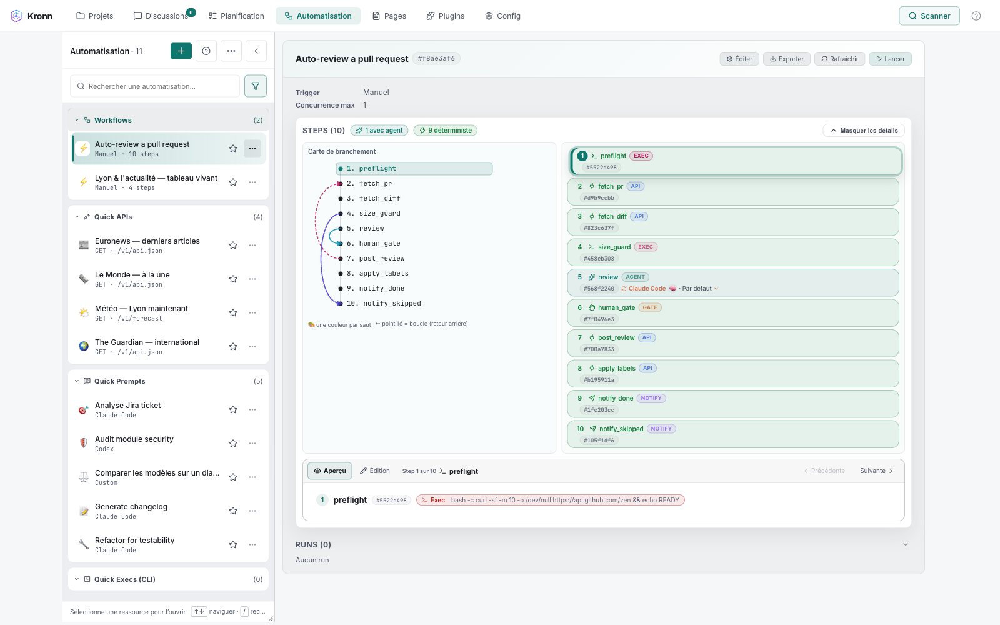
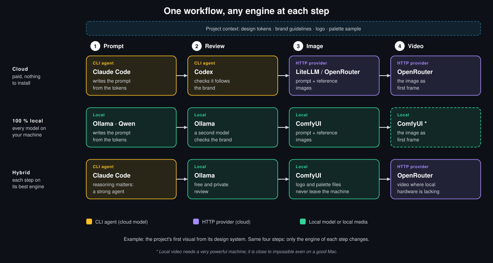
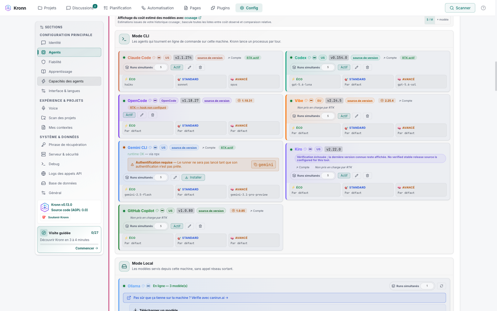
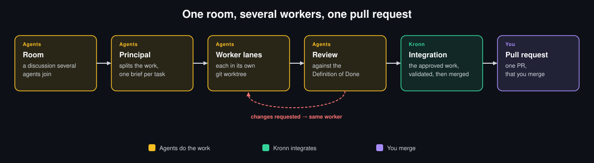
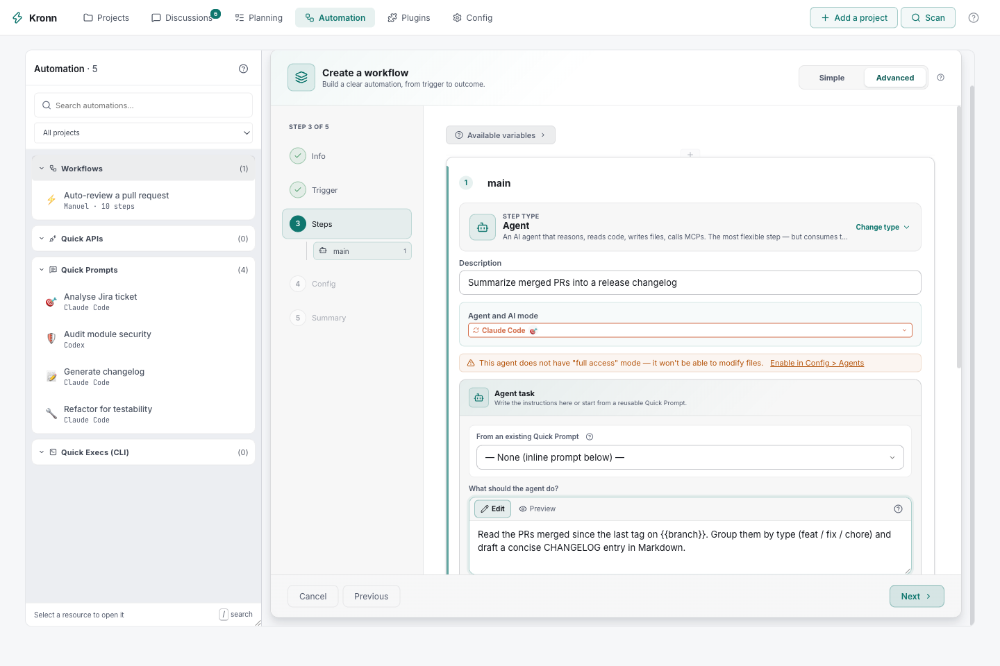
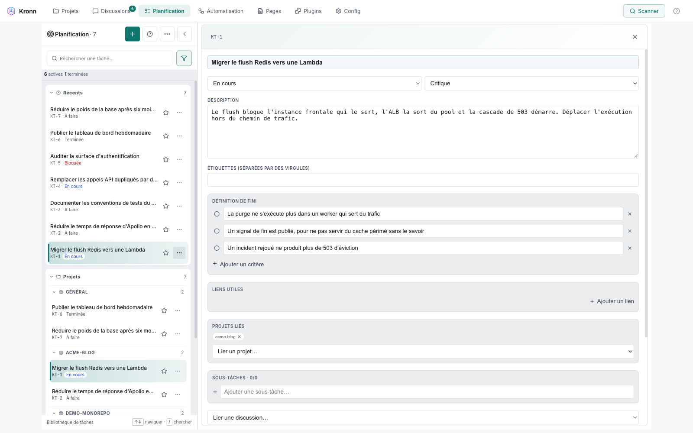
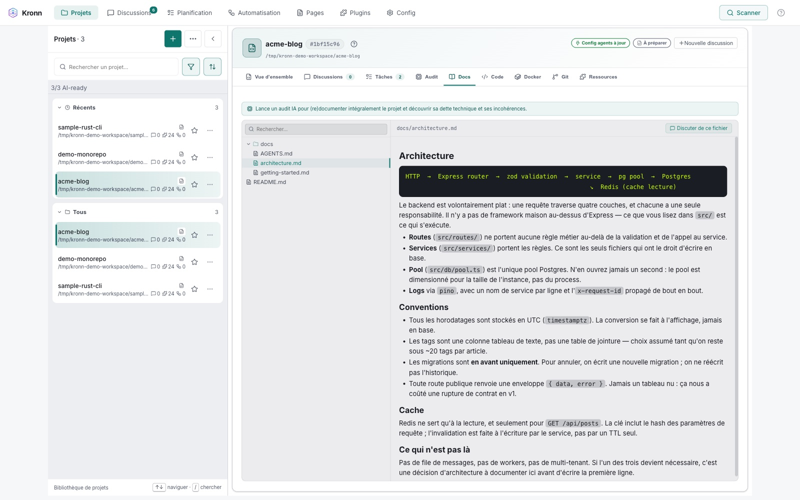
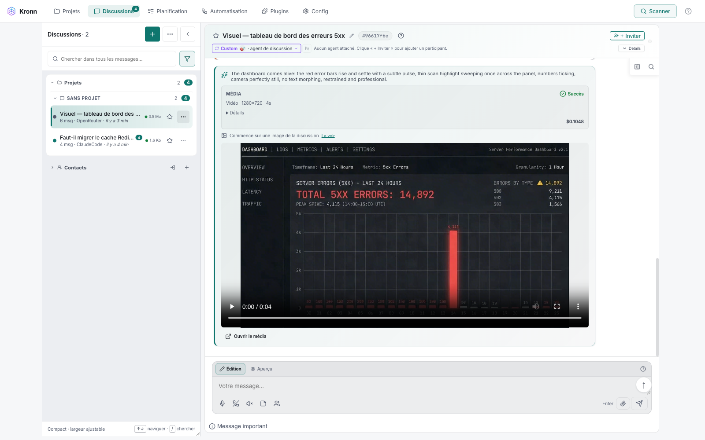
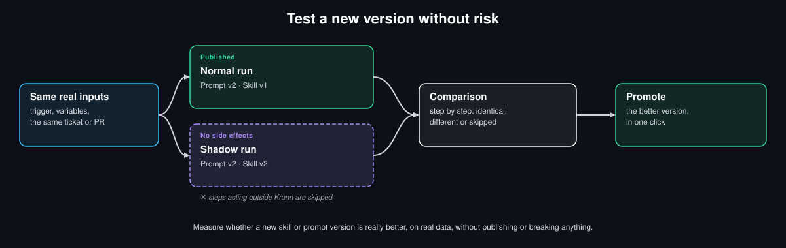
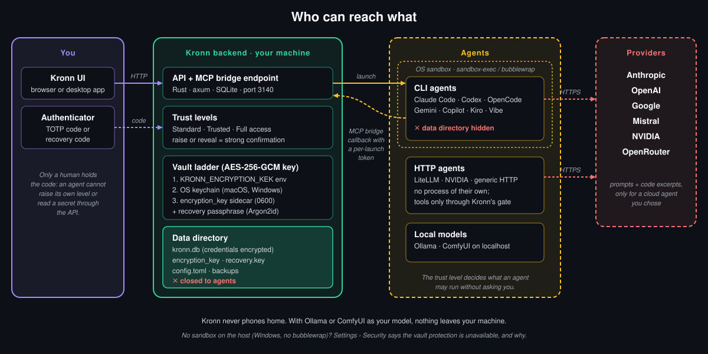

<p align="center"></p>

<p align="center">
  <a href="https://docroms.github.io/Kronn/"></a>
  &nbsp;
  <a href="README.fr.md"></a>
</p>

<p align="center">
  <a href="https://github.com/DocRoms/Kronn/releases/latest"></a>
  <a href="LICENSE"></a>
  <a href="https://github.com/DocRoms/Kronn/actions"></a>
</p>

<p align="center">
  <a href="https://github.com/DocRoms/Kronn/stargazers"></a>
  <a href="https://github.com/DocRoms/Kronn/commits/main"></a>
  <a href="CONTRIBUTING.md"></a>
  <a href="https://github.com/DocRoms/Kronn/issues?q=is%3Aopen+label%3A%22good+first+issue%22"></a>
</p>

**Run your coding agents (Claude Code, Codex, Gemini CLI, OpenCode…), local models with Ollama and HTTP providers such as LiteLLM, NVIDIA and OpenRouter from one self-hosted dashboard, with shared MCPs, encrypted secrets, multi-agent rooms and repeatable workflows.**

- **One tab instead of five terminals:** every agent shares the same MCPs *(Model Context Protocol, the open standard agents use to reach tools and data)*, secrets and project context.
- **Code where code is enough:** workflows run the mechanical steps without tokens and give each agent a small, bounded prompt. See [the Kronn way](docs/guides/the-kronn-way.md).
- **Your machine, your rules:** agents run in an OS sandbox that hides Kronn's vault, at the trust level you choose; with Ollama, nothing leaves your laptop.

> **Status: 0.15.2 (current release).** Functional but pre-1.0. Breaking changes happen between minor versions; patch versions are safe.
> **License: AGPL-3.0.** Using Kronn locally to build *your own* product is fine; the copyleft only kicks in if you distribute a modified Kronn to others. See [License notes](#license-notes-agpl-30).

## What's new in 0.15.2

- **Secrets out of agents' reach:** trust levels, an OS sandbox on Kronn's data directory, strong confirmation and a safe plugin export.
- **Quotas without lost work:** work waits, then returns to its original provider; no silent fallback.
- **Rooms that code across projects, Docker without compiling:** grant a room `code` on another project's checkout; `start` pulls multi-arch release images.

Full list of changes in the [CHANGELOG](CHANGELOG.md#0152---2026-11-08).

## One workflow, any engine

Kronn mixes any engine at each step of a workflow: CLI agents, HTTP providers and local models.
Take one example, creating the project's first visual from its design system: ① reads the repository's design tokens and brand guidelines and writes the prompt, ② checks the prompt follows the brand, ③ generates the image with the brand assets (logo, palette sample) as reference images, and ④ turns it into a short teaser. The steps work with the project's context, not raw model calls.
Cloud and 100 % local are the two ends: paid providers with nothing to install, or every model on your machine (Ollama for the text, ComfyUI for the media).
The hybrid lane shows the logic: a strong CLI agent where reasoning matters; local where it is free and private, so the brand files (logo, palette) never leave the machine; cloud where the hardware is lacking, for the video.

<p align="center"></p>

<sub>* Local video needs a very powerful machine; it is close to impossible even on a good Mac.</sub>

Import a lane: [cloud](docs/examples/design-system-first-visual.cloud.json), [100 % local](docs/examples/design-system-first-visual.local.json) or [hybrid](docs/examples/design-system-first-visual.hybrid.json), then see [what to configure](docs/examples/README.md#design-system-first-visual).

## Contents

- [What's new in 0.15.2](#whats-new-in-0152)
- [One workflow, any engine](#one-workflow-any-engine)
- [Key capabilities](#key-capabilities)
- [The Kronn way](#the-kronn-way-engineering-not-incantation)
- [Quick start](#quick-start)
- [Security model](#security-model)
- [Concepts](#concepts)
- [When Kronn fits, and when it doesn't](#when-kronn-fits-and-when-it-doesnt)
- [License and links](#license-and-links)

---

## Key capabilities

### Agents in one place

Eleven agent types behind one picker: seven CLI agents, Ollama, LiteLLM, NVIDIA and any OpenAI-compatible endpoint, each with Eco / Standard / Advanced tiers and the same MCPs.
Ollama **decision models** answer typed questions with a probability. See [Ollama local models](docs/operations/ollama-local-models.md#decision-models-kt-1366) and the [HTTP transport](docs/operations/http-transport.md).

<p align="center"></p>

### Rooms and orchestration

A **room** is a discussion that several agents join, across projects if you allow it.
The orchestrator splits the work into worker lanes, each in its own git worktree, reviews each delivery against its Definition of Done, then integrates the result into a single PR. See [task orchestration](docs/guides/task-orchestration.md).

<p align="center"></p>

### Workflows

Fifteen step types, from agent steps to zero-token `ApiCall`, `Exec` and `Gate` steps, started manually, by cron, a tracker or a **Watch** on a source.
Skills and Quick Prompts are versioned and can be pinned on a step. See the [workflow engine](docs/architecture/overview.md#workflow-engine).

<p align="center"></p>

### Planning and memory

One **Planning** backlog ranks tasks by priority band and links each one, with its blockers and **Definition of Done**, to several projects and discussions.
Agents read only the task or delta they need through MCP. See [planning and discussion plans](docs/design/planning-and-discussion-plans.md).

<p align="center"></p>

### Repository AI docs

An audit writes a `docs/` tree every agent reads as project context; revalidation re-audits only what drifted.
The Full audit is chained: 9 docs steps, then every focused pass (Security, Performance, Accessibility, CodeQuality…), 16 steps in one launch.
The anti-hallucination guard flags invented files and lines. See the [audit guide](docs/guides/ai-audit.md) and the [anti-hallucination guard](docs/conventions/anti-hallucination-guard.md).

<p align="center"></p>

### Live Pages and media

An **Artifact** (Live Page) is a sandboxed, versioned HTML report fed by workflow datasets, whose row buttons launch a Quick Prompt, an API call or a workflow.
An image or a clip can start from several source images, on ComfyUI too (FLUX.2 Klein 4B takes up to four), and a workflow step on a local or HTTP agent (Ollama, LiteLLM…) generates media itself. Generated clips chain into one film in the discussion. See [Live Pages](docs/architecture/live-pages.md) and [media generation](docs/architecture/media-generation.md).

<p align="center"></p>

## The Kronn way: engineering, not incantation

Decompose: code does what code can do (fetch, transform, run a command) without spending a token, and an agent only steps in where judgement is needed, with a small, bounded prompt.
Measure: skills and Quick Prompts are versioned, and a shadow run shows whether a new version is really better before it goes live. See [the Kronn way](docs/guides/the-kronn-way.md).

### Test a new version without risk (shadow runs)

Each normal run of a workflow can start a shadow run on the same real inputs, loading the skill or Quick Prompt version you are testing.
Every step marked as acting outside Kronn (posting, sending, writing elsewhere) is skipped in the shadow, and so is every Gate: it publishes and breaks nothing.
The run list compares both runs step by step, and one click promotes the better version. See the [shadow runs guide](docs/guides/shadow-runs.md).

<p align="center"></p>

---

## Quick start

**Prerequisite:** at least one local CLI agent, [Ollama](https://ollama.com), or an existing LiteLLM proxy. Kronn drives the runtime you already use; it does not ship its own LLM. The setup wizard detects what is on your `$PATH`, with an `npx` fallback for npm-published agents.

### Desktop app: recommended for solo use

Download the installer for your OS from [Releases](https://github.com/DocRoms/Kronn/releases/latest). No Docker, no extra runtime. Per-OS steps in [docs/install.md](docs/install.md).

### Docker: published images

```bash
git clone --branch 0.15.2 --depth 1 https://github.com/DocRoms/Kronn.git   # latest stable release
cd Kronn
./kronn start        # guided setup & launch (Docker) → http://localhost:3140
```

`./kronn start` (and `make start`) pulls the published images (`ghcr.io/docroms/kronn-backend` and `-frontend`, amd64 and arm64) and compiles nothing. Source builds, their memory check and how `VERSION` picks the image: [docs/install.md](docs/install.md#published-images-and-source-builds). On Windows, use WSL2.

### macOS and contributors: `start-dev`

Docker on macOS cannot run your host agents or read the Keychain, so on a Mac use `./kronn start-dev`: backend and UI run natively, with backend hot-reload. It needs Rust, Node ≥ 24, pnpm and Watchexec, and names any missing tool with an install hint. Details: [docs/install.md](docs/install.md#develop--run-from-source-natively-no-app-build-hot-reload).

**First 5 minutes:** open a project the wizard found (Kronn adopts its `.mcp.json`), start a discussion with an agent, then save a useful prompt as a Quick Prompt with `{{variables}}`. When you want multi-step, scheduled or gated work, move on to a [workflow](docs/architecture/overview.md#workflow-engine).

---

## Security model

<p align="center"></p>

- **Trust levels.** Standard (every sensitive action asks), Trusted and Full access, set for the instance, a workflow or a room; the narrowest setting wins. A level approves on your behalf only what protects you from your own agents, journals it, and takes it back when lowered. See [trust levels](docs/architecture/trust-levels.md).
- **OS sandbox.** Native agent processes and everything a level approves run under `sandbox-exec` (macOS) or bubblewrap (Linux), which hides Kronn's data directory: database, keys, configuration, backups. The network and your other files stay as in your terminal. Without a sandbox (Windows, no bubblewrap), Settings › Security says the protection is unavailable. See [agent vault protection](docs/architecture/agent-vault-protection.md).
- **Strong confirmation.** Once you enrol an authenticator app (TOTP, plus ten recovery codes), raising a trust level and the routes that reveal a secret or destroy data ask for its code, whatever the channel, loopback included. See [strong confirmation routes](docs/architecture/strong-confirmation-routes.md).
- **The vault.** Credentials are encrypted (AES-256-GCM) in the database; `config.toml` holds no secret. The key comes from a ladder: the `KRONN_ENCRYPTION_KEK` environment variable, then the OS keychain (macOS and Windows release builds; Linux has none), then an `encryption_key` sidecar file (`0600`) in the data directory. A recovery passphrase (Argon2id) wraps the key in `recovery.key`, so it survives the loss of the machine. See [key management](docs/operations/key-management.md).
- **Stays local.** Prompts go only to the provider *you chose* (nobody, with Ollama). Kronn never phones home.
- **Container/host boundary.** Docker mode mounts your `$HOME` read-only, masks the credential paths it finds (`~/.ssh`, `~/.aws`, …) and mounts no Docker socket by default. See [docs/install.md](docs/install.md).
- **Hardening.** SSRF guards on API plugins (RFC 1918, IPv6 ULA, DNS-rebind detection). `Exec` steps are allowlist-gated, with no `sh -c` and literal argv only. Auth and TLS: [docs/operations/auth-and-tls.md](docs/operations/auth-and-tls.md).
- **Bus factor.** One core maintainer today, AGPL-3.0, all design and contribution docs under [docs/](docs/AGENTS.md). Forks are welcome; any agent backend can be replaced without touching the engine.

---

## Concepts

| Term | What it is |
|---|---|
| **Project** | A git repository Kronn knows, with its AI docs and drift detection. |
| **Discussion / room** | A chat with one agent, a multi-agent debate, or a room several CLIs join through MCP; optionally in its own git worktree. |
| **Task, plan, DoD** | One ranked task shared by projects and discussions, with subtasks, blockers and a Definition of Done. |
| **Worker** | An agent that executes one task in its own worktree and sub-discussion, reviewed by the room's principal. |
| **Quick Prompt / Quick API / Quick Exec** | Reusable prompt template with `{{variables}}`; saved API call; bounded, shell-free CLI collector. |
| **Workflow** | A multi-step pipeline (15 step types) started manually, by cron, a tracker or a Watch. |
| **Shadow run** | A side-effect-free replay of a real run on other skill or Quick Prompt versions. |
| **Artifact (Live Page)** | A sandboxed, versioned HTML report backed by JSON datasets. |
| **Profile / Skill / Directive** | Who the agent is, what it knows, how it talks: 18 built-in profiles, 30 built-in skills, plus your own. |
| **Plugin** | MCP, API, hybrid or Custom API integration with encrypted secrets: 55+ built in (GitHub, GitLab, Jira, Slack, Stripe…), any REST API through Custom API. |
| **Trust level** | Standard, Trusted or Full access: what agents may do without asking, per instance, workflow or room. |

Every other term: [docs/glossary.md](docs/glossary.md).

---

## When Kronn fits, and when it doesn't

**Fits** if you run several AI CLIs and want to **decompose AI work into bounded workflows** (PR review, audit, generate-from-spec, batch over tickets) where mechanical steps are deterministic code and AI only fires on reasoning. Bonus: self-hosted, with secrets in your own vault.

**Doesn't fit** for pure RAG pipelines, in-process Python orchestration (LangGraph is the better path), or workloads that need managed multi-tenancy. Kronn is a **mixed-step workflow engine (CLI agents + deterministic code) on local files**, not a Python LLM framework, not a multi-tenant SaaS.

**Vs other tools:**

| Tool | Why not them | Where Kronn fills the niche |
|---|---|---|
| **Cursor / Copilot Workspace** | One agent, one mega-prompt, no workflow engine, no batch, no compare-agents | When you want to graduate from one-shot to a repeatable, auditable pipeline |
| **n8n** | Generic automation, no agent context, no MCP | When AI is one step among others, not the orchestrator itself |
| **Temporal** | Durable execution at massive scale (Uber/Stripe-grade) with replay + signals; overkill for orchestrating CLI agents on a laptop, no AI primitives | When you want the workflow pattern without Temporal's operational footprint |
| **LangGraph** | Python in-process, no CLI agents, no MCP plumbing, no compare-agents | When you want to orchestrate the real CLIs (Claude, Codex…) with their own caches/sessions |
| **LiteLLM** | LLM API router, but no workflow or CLI-agent control plane | Kronn uses your LiteLLM proxy as a first-class discussion/workflow agent while adding projects, tools and orchestration |

---

## License and links

### License notes (AGPL-3.0)

In practice, for the 99% of users:

- **Use Kronn locally to code your own product?** AGPL doesn't apply to that. You're not distributing Kronn.
- **Run Kronn as a SaaS for other users?** AGPL applies: your modified Kronn must be open-sourced too.
- **Fork Kronn for internal use within your company?** AGPL doesn't kick in (no distribution outside the org).

Full text in [LICENSE](LICENSE). If your legal team wants more nuance, dual-licensing discussions are open.

### Links

- [Website](https://docroms.github.io/Kronn/): the Kronn pitch site (FR / EN / ES)
- [docs/install.md](docs/install.md): install per OS, Docker, WSL2, Tauri desktop
- [The Kronn way](docs/guides/the-kronn-way.md): decomposition, batches, compare-agents, local models
- [docs/architecture/overview.md](docs/architecture/overview.md): backend/frontend topology, workflow engine reference
- [docs/architecture/trust-levels.md](docs/architecture/trust-levels.md): trust levels, sandbox, strong confirmation
- [docs/AGENTS.md](docs/AGENTS.md): full reference for contributors (humans and AI agents)
- [CONTRIBUTING.md](CONTRIBUTING.md): DCO, coding rules, test policy
- [CHANGELOG.md](CHANGELOG.md): release notes
- [LICENSE](LICENSE): AGPL-3.0
