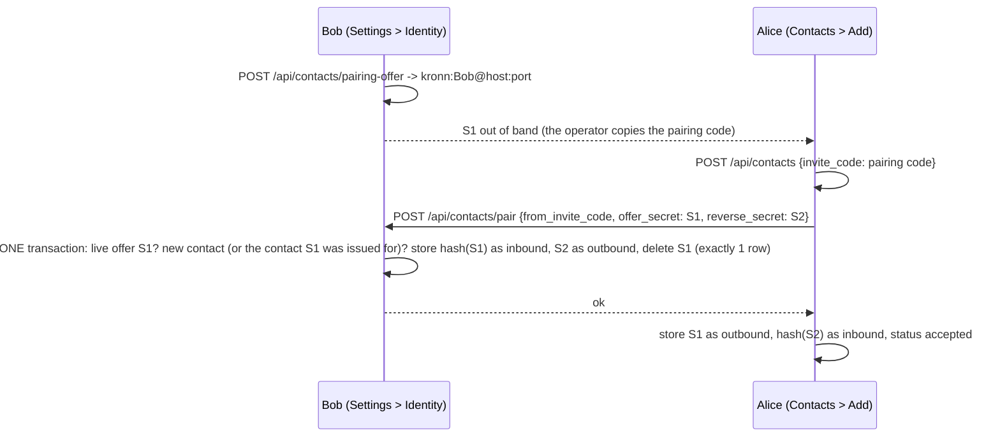

# P2P contact pairing: per-contact secrets (KT-1650)

Status: shipped. Found by KT-1597, see
[the invite-code gotcha](../gotchas/contact-invite-code-not-a-secret.md).

## Owner decision (2026-11-10)

- **Existing contacts RE-PAIR.** There is no compatibility with older peers and
  no migration of the old pairing: a peer that does not present the per-contact
  secret is refused. Almost nobody uses the feature today, so breaking old
  pairings is accepted.
- **The refusal says how to re-pair, to both sides.** The text is one constant
  per transport: `PEER_REFUSED` for HTTP routes, `WS_REFUSED_REASON` for the
  WebSocket close reason (123 bytes at most on the wire), `REPAIR_HINT` in the
  operator's own log. [src: file: backend/src/db/contacts.rs:86]
  [src: file: backend/src/db/contacts.rs:92]
- **Later (KT-1242, P2P agents post-1.0):** other people's agents will give their
  view inside a discussion. The design below keeps that open (per-contact
  identity, an authenticated channel, room membership checked per write) and
  builds none of it: no room-scoped grant, no agent identity on the wire.

## The problem

The invite code is `kronn:pseudo@host:port`, public and deterministic. It used to
be the only credential of a contact, so anyone who knew a pseudo and an address
could pass the WS presence, `claim-by-token`, `fetch-file` and the FileAttached
host resolution as that contact.

## The design

Each paired contact carries **two** random secrets, one per direction, like a
password and its verifier:

| Column (`contacts`) | Holds | Used for |
|---|---|---|
| `inbound_secret_hash` | SHA-256 (hex) of the secret the peer must present to us | verifying the peer; the clear value is never kept |
| `outbound_secret` | the secret we present to the peer | sending it; it must be clear to be sent, never listed nor returned by an API |

A secret is 256 bits from the OS RNG, hex-encoded
[src: file: backend/src/db/contacts.rs:102]; it is never derived from the invite
code or any public value. It is compared as two SHA-256 digests in constant time
[src: file: backend/src/db/contacts.rs:124]. Migration 297 adds the columns and
the offer table. [src: file: backend/src/db/sql/297_contact_pairing_secrets.sql:1]

### Pairing flow

- The operator who generates a pairing code consents to the contact: the
  contact it creates is `accepted` at once, on both sides.
  [src: file: backend/src/api/contacts.rs:34]
  [src: file: backend/src/api/contacts.rs:59]
  [src: file: backend/src/api/contacts.rs:221]
- `/api/contacts/pair` is auth-exempt (the caller has no token yet) and gated
  only on a live pairing code. [src: file: backend/src/lib.rs:751]
- **An offer pairs a NEW contact only, unless it was issued for an existing
  one.** `contact_pairing_offers.contact_id` (migration 298) is set when the owner
  re-pairs a `needs_repair` contact from its sidebar entry ("Re-pair" calls
  `pairing-offer` with the contact id). `accept_pairing` then refuses: an
  unbound offer that meets an existing contact (any status), a bound offer whose
  `from_invite_code` is not exactly that contact, a paired or refused contact. So
  a live offer can never rebind another contact's row (its id, shared
  discussion memberships, context files) to the secrets of whoever holds it.
  A paired contact has to be deleted on both sides first; deleting a contact
  drops the offers issued for it.
- **A bound offer cannot be evicted or crowded out.** Issuing an offer bound to a
  contact first deletes the earlier offers bound to that same contact (at most
  one live bound offer per contact, so repeated Re-pair clicks never pile up).
  The 20-offer cap applies to UNBOUND offers only: it evicts the oldest unbound
  ones, never a bound one, and bound offers do not count against it (they are
  bounded by the contact count).
- **Every write is conditional and transactional.** `set_pairing_secrets` only
  updates a contact with no secrets that is not `refused`, and says whether a
  row changed. `accept_pairing` (accepting side) runs find offer, insert contact,
  set secrets and delete offer in one SQLite transaction; the offer must delete
  exactly one row, anything else rolls back and refuses, so single use is
  enforced by the write and not by the earlier read. `complete_outbound_pairing`
  (initiating side, after the peer answered) re-checks the contact in its own
  transaction: a contact paired, refused, deleted or created meanwhile is not
  overwritten and the operator is told to delete both sides and pair again.
- A bare invite code (an address) is refused by `POST /api/contacts` with the way
  to get a pairing code, and nothing is stored. A pairing needs the network: an
  unreachable peer or P2P off stores nothing.
- The secrets travel once, in that pairing request, then in every P2P request.
  They are on the wire in clear unless the transport carries TLS; Kronn already
  refuses to be exposed on plain HTTP beyond loopback (see
  [auth and TLS](../operations/auth-and-tls.md)).

### Where the secret is required

| Route | Check |
|---|---|
| WS `Presence` | `admit_peer_presence`: contact by code, secret, `accepted`. Admission then holds the **contact id**, never the code. The secret is cleared before the Presence reaches the local bus. [src: file: backend/src/api/ws.rs:846] |
| `POST /api/disc/claim-by-token` | `authenticate_peer` [src: file: backend/src/api/disc_invite.rs:2391] |
| `POST /api/disc/fetch-file` | `authenticate_peer`, then the entitlement re-checks run on the contact id [src: file: backend/src/api/disc_invite.rs:2547] |
| FileAttached host resolution | the host is the authenticated peer the frame came from, not the public `from_invite_code` it carries; the fetch presents our `outbound_secret` [src: file: backend/src/api/federation.rs:426] |
| Outbound (WS client, claim, fetch) | present the contact's `outbound_secret`; a contact without one is not dialled nor asked [src: file: backend/src/core/ws_client.rs:243] |

`authenticate_peer` is the only function that turns a code into a contact for a
peer, and it needs the secret. [src: file: backend/src/db/contacts.rs:143]
`PeerAuth` has a single variant, the contact id, so no public-code path remains.
[src: file: backend/src/api/ws.rs:1027]

Every refusal on one route is worded the same (unknown code, wrong or missing
secret, contact not accepted, contact never paired): no oracle. A refused WS peer
gets a close frame (code 4401) carrying the re-pair instruction.
[src: file: backend/src/api/ws.rs:563]

### Old contacts, imports

- The migration moves every `accepted` / `pending` contact without secrets to
  status `needs_repair`: the row (and so its shared discussions, which point at
  the contact id) stays, but it is neither dialled nor admitted.
  [src: file: backend/src/db/contacts.rs:67]
- To re-pair such a contact, the owner clicks Re-pair on its sidebar entry: that
  issues a pairing code bound to the contact and shows it; the other side pastes
  it in Add contact and the row is paired in place (same id, same shared
  discussions). Pasting a pairing code for such a contact on the initiating side
  pairs it in place too, but the accepting side needs a code issued for it, so
  both sides must take part. The sidebar shows a "re-pair" badge.
- An export never carries secrets, so an import brings accepted contacts back as
  `needs_repair`.
- Incoming contact requests (an unknown code at Presence) are unchanged: they
  only tell the operator someone wants to connect; pairing needs a pairing code.

### Limits

- **Owner-trust model of the offer.** Whoever holds a live unbound offer chooses
  the host the new contact is dialled at (the `from_invite_code` of the request
  becomes its address; a bound offer keeps the row's own address). The offer is a secret the owner hands to the intended peer;
  a leaked offer is single use, valid 7 days, and revocable by not using it (it
  is also dropped when the contact it was issued for is deleted). It cannot
  rebind an existing contact unless it was issued for that one. Whoever holds an
  offer issued for a contact can still present themselves as that contact (same
  invite code), so give it to that peer only.
- A pairing we start whose final write is refused (the contact changed while the
  peer was asked) leaves the peer holding our secret: delete the contact on the
  peer and pair again.

- The two secrets are not rotated; deleting the contact on both sides and pairing
  again is the revocation.
- A pairing request whose answer is lost leaves the offer spent on the accepting
  side: delete the contact there and pair again.
- Peers are authenticated by a shared secret, not a signed challenge: a peer that
  reads traffic on a plain-HTTP path can replay it. That is why TLS is mandatory
  beyond loopback.
