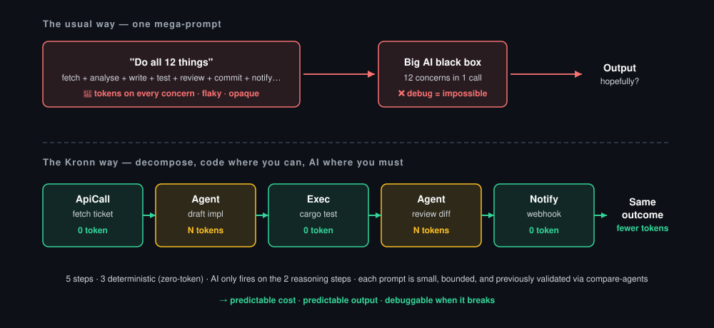
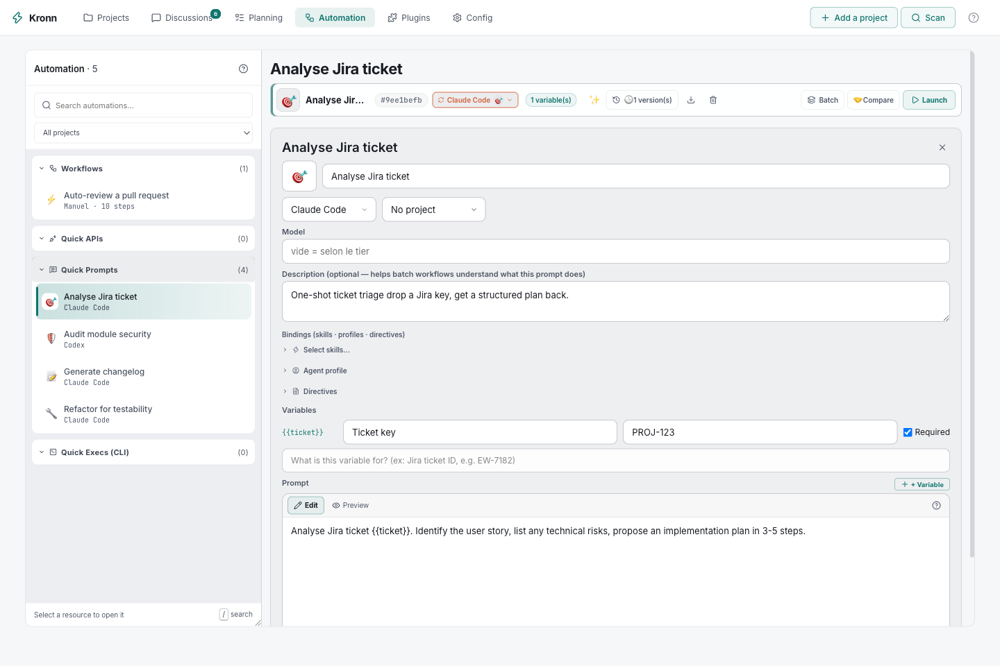
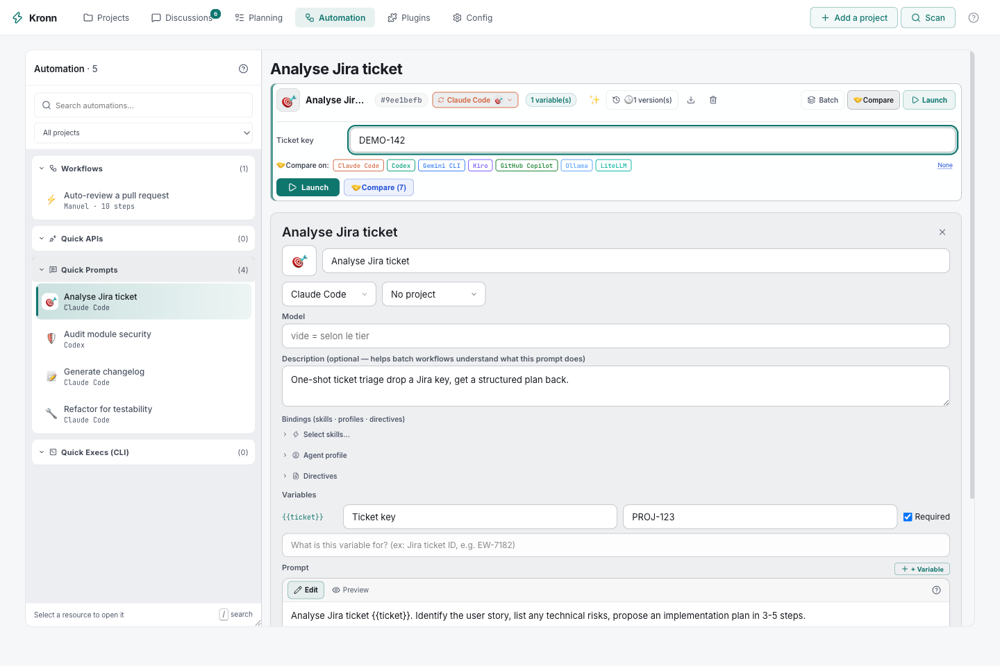

# The Kronn way: engineering, not prompting

Most "AI-powered" workflows rely on one mega-prompt that asks the agent to do a
dozen things at once: expensive in tokens, flaky in output, opaque when it
breaks, non-deterministic by nature. Kronn takes the other road.

  

1. **Decompose** the task into a workflow of small, bounded steps.
2. **Use code where code is enough**: `ApiCall` to fetch, `JsonData` for
   fixtures, `Exec` for a command, `Notify` for webhooks, `BatchApiCall` to fan
   out N HTTP calls in parallel. Zero tokens, deterministic, debuggable.
3. **Use AI only on the reasoning step**, with a small focused prompt, which is
   naturally more reliable than a prompt juggling a dozen concerns. To run it
   across N items, `BatchQuickPrompt` fans it out in parallel discussions.
4. **Validate each prompt with compare-agents.** If Claude, Codex and Gemini
   converge on the same answer, ship it. If they diverge, the prompt is
   ambiguous: fix it before it costs you 30 times in a batch.
5. **Eco-design by default**: tokens burn only where they earn their cost. Less
   spend, less carbon, more predictable output.

This is what sets Kronn apart from an editor assistant (one prompt, one agent)
and from LangGraph (Python only, no CLI agents, no compare).

## A workflow that spends tokens only on reasoning

A typical Auto-Dev workflow:

- `ApiCall` fetches the Jira ticket: **0 tokens**
- `Agent` (a small prompt validated with compare-agents) drafts the
  implementation: **N tokens**, the only step where reasoning matters
- `Exec` runs `cargo test`: **0 tokens**
- `Agent` (a small prompt) reviews the diff against the tests: **N tokens, bounded**
- `Notify` posts the result to Slack: **0 tokens**

Five steps, three deterministic: predictable cost, predictable output,
debuggable when it breaks. You build it in the wizard (step types, autocomplete
on agent, API and Quick Prompt references) and can export or import Kronn's
versioned JSON bundle. The workflow model shares Symphony's four workspace-hook
names, but Kronn does not import `WORKFLOW.md` files.

## Batch a Quick Prompt over N tickets

Save `Analyse {{ticket}} and draft a PR` as a Quick Prompt. Paste 30 Jira keys,
or pull them from a tracker step. Kronn fans out one discussion per item, in
parallel, each in its own git worktree if you want isolation, and lands them
all behind a single human-approval Gate so nothing merges without you.

> **A concrete run** (a 30-ticket batch on Claude Sonnet, about 4k input and 6k
> output tokens per ticket, prompt caching on): about $3 of API spend, about
> 3 minutes of wall time, no manual copy-paste. The same batch on Ollama with
> `qwen3.8:27b` running locally costs $0 and a few minutes, depending on your
> hardware.

  

## Compare agents before you ship a prompt

Before you wire a prompt into a workflow, click **Compare** on any Quick Prompt.
Every target uses the shared agent and model picker: compare Claude, Codex,
Gemini, Vibe or Ollama, or two tiers of the same agent. The rendered prompt runs
in parallel, and the Markdown answers appear side by side in a dedicated
workspace. Each column keeps a durable discussion you can open to continue the
work. Compare-agents is the QA gate of prompt engineering: cheap to run once,
and it catches a bad prompt before it enters production.

  

## Stay local with Ollama, or reuse your LiteLLM proxy

Run Llama, Gemma, Qwen or Codestral on your machine through Ollama as a
first-class agent: same Discussions, Quick Prompts and Workflows, with calls
routed to `http://localhost:11434/v1/` instead of the cloud, and the default
model picked in Settings. No token bill, no code leaving your laptop.

Already route models through LiteLLM? Declare the endpoint and an optional key,
test the connection, then map the models your proxy reports to Kronn's Economy,
Default and Reasoning tiers. Ollama and LiteLLM can both call Kronn's native
tools from a discussion. See [Ollama local models](../operations/ollama-local-models.md)
and the [HTTP transport](../operations/http-transport.md).
